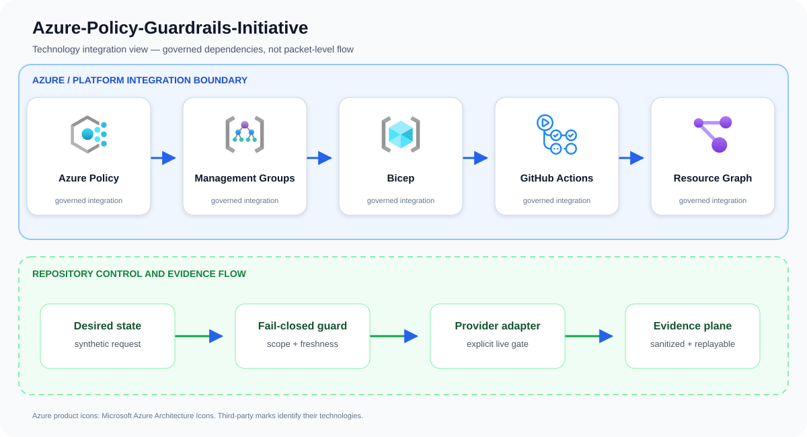
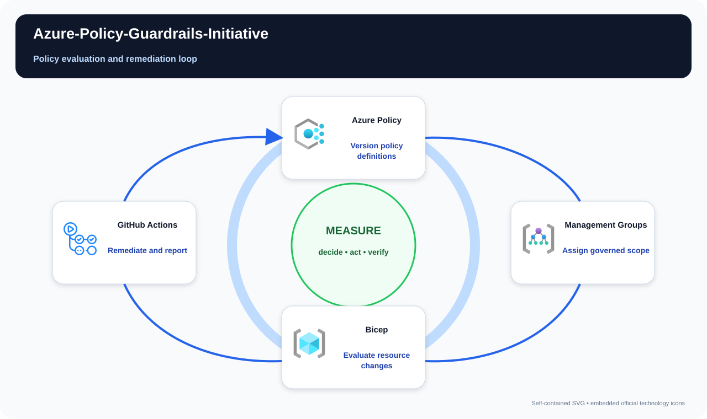

# Azure-Policy-Guardrails-Initiative

Create a scalable Azure Policy initiative that prevents or remediates high-risk configuration drift.

## Problem statement

A management-group policy promotion request is checked for tenant, approved target, evidence freshness, private defaults, and deterministic rollback evidence before assignment.

A production implementation can still fail even when every resource deploys successfully. The material risk is configuration that passes syntax checks but violates control intent, or an exception that reaches farther and lasts longer than expected. The design therefore treats Azure Policy, Management Groups, Bicep, and the surrounding identity and evidence controls as one reviewable system rather than unrelated configuration tasks.

## Example case study

### Situation

A cloud center of excellence manages hundreds of subscriptions where encryption, private endpoints, and ownership tags drift over time. The initiative moves those expectations into preventative controls applied consistently at hierarchy level.

### Response

A platform team introduces a public-network restriction at management-group scope. Representative subscriptions are evaluated first, an ownerless exemption is rejected, and the approved rollout gives both platform and application teams a traceable decision record.

The team first exercises the repository's synthetic approved and denied fixtures. An approved request must produce the same idempotent plan on replay; a stale, unscoped, public, or unapproved request must fail before an Azure adapter is allowed to run.

### Expected outcome

Stakeholders receive a decision package they can attach to a change record: requested scope, controls evaluated, the reason for approval or denial, and the explicit handoff to live integration. The example supports design review and incident rehearsal without pretending that a local test changed Azure.

## Architecture

Custom definitions and carefully selected built-ins are grouped by control objective, parameterized by environment, assigned through management groups, and deployed via Bicep with exemptions, remediation identities, versioning, and evidence reporting.

Primary services: `Azure Policy`, `Management Groups`, `Bicep`, `GitHub Actions`, `Resource Graph`.

This repository implements the first production-oriented vertical slice: a
fail-closed, adapter-neutral control plane that validates tenant scope,
freshness, approvals, secretless identity, private access, and the exact
project action before producing a deterministic execution plan. Azure adapters
consume that plan; they are deliberately outside the local simulator so local
tests cannot claim a live cloud change occurred.



The upper boundary names the principal services and technologies used by this repository. The lower boundary shows the implemented control flow: desired state is validated, provider action remains an explicit integration gate, and sanitized evidence is retained for review and deterministic replay.

## Best complementary diagram

**Recommended view: Policy evaluation and remediation loop.** A control-loop view is the strongest complement because it shows how observed state becomes a bounded decision, an action, and measured feedback.



The view follows **Version policy definitions → Assign governed scope → Evaluate resource changes → Remediate and report**. Use it during design reviews, operational walkthroughs, and failure-mode discussions; use the logical architecture above when the question is which technologies integrate.

## Quickstart

Requirements: Python 3.11+ and Git. No Azure credentials are required.

```bash
./scripts/validate.sh
python3 src/control_plane.py --request examples/approved-request.json
```

The command emits canonical JSON with a stable idempotency key. The denied
fixture exits with status 2 and explains the failed invariants.

## Security boundaries

- Managed identity or workload identity only; embedded credentials are denied.
- Public network access and stale evidence are denied.
- Production and break-glass targets require explicit approval.
- The IaC entry point is opt-in and defaults to deploying nothing.
- Evidence output contains identifiers and decisions, never credential values.

## Verification and limitations

Local validation covers 13 tests, deterministic replay, JSON parsing, Python
compilation, ignore hygiene, and Bicep compilation when a compiler is present.
It does **not** prove Azure deployment, service licensing, quota, data-plane
permissions, provider/API availability, cloud failover, load, cost, or teardown.
See [`docs/test-matrix.md`](docs/test-matrix.md) and [`docs/runbook.md`](docs/runbook.md) before any integration trial.

## Community

See [`CONTRIBUTING.md`](CONTRIBUTING.md), [`SECURITY.md`](SECURITY.md), [`SUPPORT.md`](SUPPORT.md), and [`LICENSE`](LICENSE). The reference
is intentionally conservative and uses synthetic identifiers only.

## Repository guide

- [Architecture](docs/architecture.md)
- [Threat model](docs/threat-model.md)
- [Operations runbook](docs/runbook.md)
- [Test matrix](docs/test-matrix.md)
- [Cost model](docs/cost-model.md)
- [Security policy](SECURITY.md)
- [Contributing guide](CONTRIBUTING.md)
- [Support policy](SUPPORT.md)
- [Changelog](CHANGELOG.md)
- [License](LICENSE)

## Infrastructure inputs

Resource behavior and deploy-time values are intentionally separated:

- [Bicep template](infra/main.bicep) — Azure resources, modules, and security controls.
- [Bicep parameters](infra/main.bicepparam) — environment-specific names, regions, identities, and feature inputs.

Start with the parameter file's safe values, replace synthetic identifiers, and run an Azure what-if before deployment.

## Attribution

Azure product icons come from [Microsoft's official Azure Architecture Icons](https://learn.microsoft.com/azure/architecture/icons/). Open-source marks are sourced from [Simple Icons](https://simpleicons.org/) when shown; each mark identifies its respective technology.
